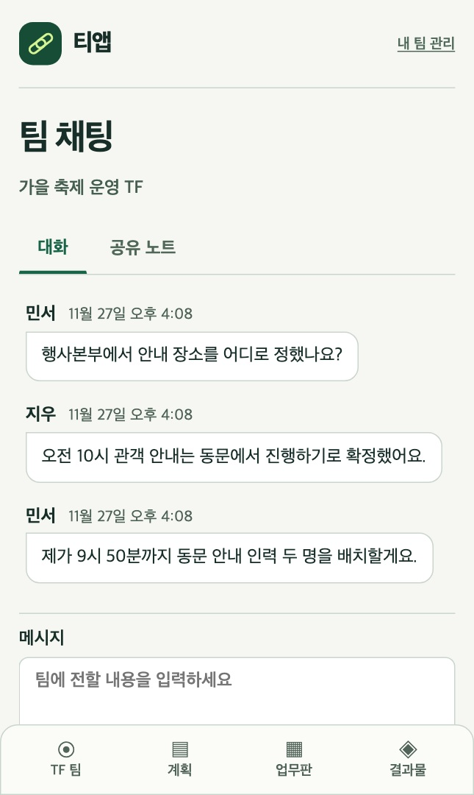
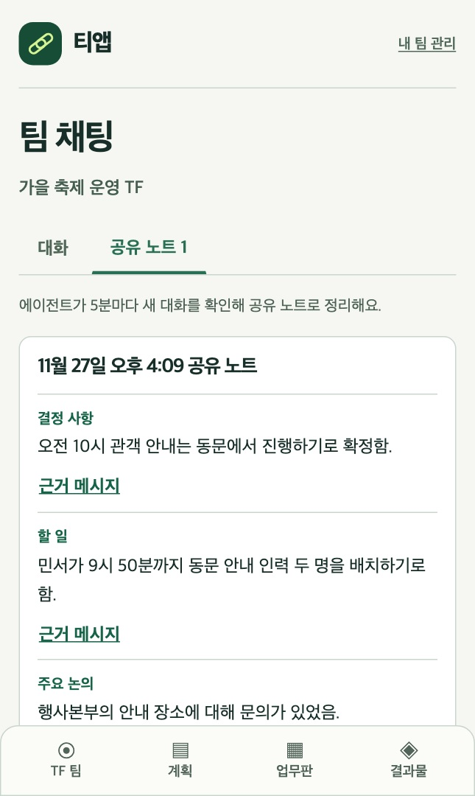
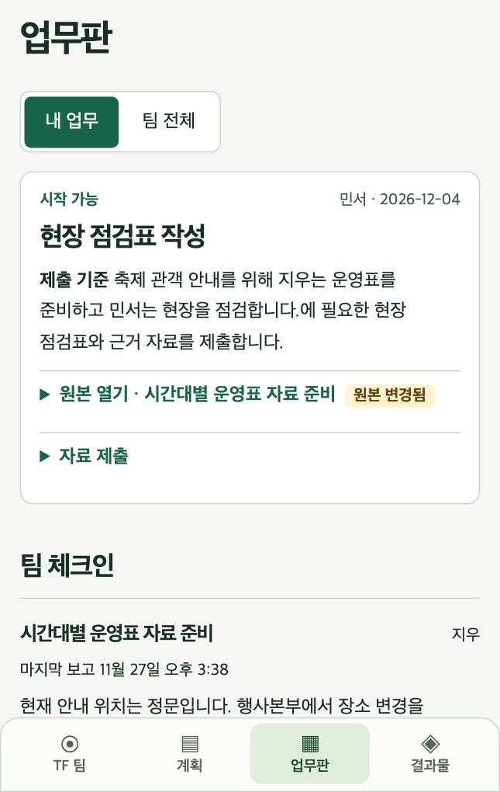

# 티앱

대학 축제 당일, 오전 10시 관객 안내 장소가 정문에서 동문으로 바뀌었다. 이미 정문 운영표를 읽은 현장 담당자는 어떻게 변경을 알아차릴까? 티앱은 팀 채팅에서 내린 결정, 수정한 운영표, 담당자의 업무 카드를 연결하는 모바일 협업 웹앱이다.

**2026년 11월 27일 Codex 대학생 해커톤 출품작 · 58개 팀 중 12위**

## 84초 시연

[YouTube에서 시연 보기](https://youtu.be/3j2zqB8WXXQ) · [제출 영상 MP4](./티앱_제출용_팀채팅과_공유노트.mp4)

| 00:25 · 팀 채팅 | 00:33 · 공유 노트 | 00:51 · 업무판 |
| --- | --- | --- |
|  |  |  |

시연에서는 민서와 지우가 각자의 모바일 브라우저로 같은 팀에 참여한다. 계획 생성과 최종 취합에는 고정 예시 응답을 사용했다. 공유 노트는 실제 모델이 작성했고, 촬영 때는 기본 5분인 요약 주기를 30초로 줄였다.

## 팀이 일하는 흐름

1. **팀 구성과 계획** — 팀장이 목표와 마감을 입력하고 초대 링크로 팀원을 모은다. 팀원 일정에 맞춰 제안된 담당자, 마감일, 선행 업무를 검토한 뒤 계획을 확정한다.
2. **자료 제출과 인계** — 지우가 운영표를 제출하면 민서의 현장 점검 카드가 ‘시작 가능’으로 바뀐다. 민서는 카드에서 표 원본을 열어 자신이 맡은 시간과 장소를 확인한다.
3. **체크인과 팀 채팅** — 진행 상황을 체크인으로 남기고 장소 변경은 팀 채팅에서 논의한다. 에이전트가 새 대화를 공유 노트로 정리하면 결정 사항과 할 일에서 근거 메시지로 돌아갈 수 있다.
4. **원본 변경 확인** — 지우가 정문을 동문으로 고치면 이미 표를 읽은 민서의 카드에 ‘원본 변경됨’이 뜬다. 민서가 최신 표를 다시 열면 표시가 해제된다.
5. **결과물 확정** — 민서가 동문 안내 인력 두 명의 배치를 확인해 제출한다. 팀장은 운영표와 점검 결과를 검토하고 최종 운영안을 팀에 공유한다.

## 개발 방식

Codex와 함께 사용자 시나리오를 단계별로 구현했다. 각 단계에서 먼저 기대 동작을 테스트로 작성하고, 구현 뒤 검증 명령과 결과를 기록했다. 예를 들어 인계는 두 팀원의 브라우저 세션을 열어 둔 상태에서 검증한다. 한쪽에서 제출하면 다른 쪽의 카드가 열리는지, 원본을 고치면 읽었던 팀원에게 다시 확인할 표시가 뜨는지까지 확인한다.

- **화면과 서버** — Next.js App Router, React, TypeScript로 모바일 화면과 API를 구현했다. 팀, 업무, 제출 자료, 대화는 서버의 SQLite에 저장한다.
- **모델과 업무 규칙** — 모델은 계획 초안, 대화 요약, 최종 취합을 작성한다. 서버가 계획의 일정과 업무 의존 관계를 검증하고 팀원이 계획과 결과물을 확정한다.
- **검증** — Vitest로 저장·검증 로직과 API를 확인하고 Playwright로 모바일 초대, 인계, 채팅, 최종 검토 흐름을 재현한다.

[단계별 구현 기록](phases/) · [제품 기획](docs/PRD.md) · [아키텍처](docs/ARCHITECTURE.md) · [기술 결정](docs/ADR.md) · [UI 가이드](docs/UI_GUIDE.md) · [제출 문안과 시연 대본](docs/제출자료.md)

## 로컬에서 시연하기

Node.js 22.13 이상에서 다음 명령을 실행한다. 예시 모드는 API 키 없이 동작한다.

```sh
npm ci
TF_TEST_MODEL=1 npm run dev
```

브라우저에서 `http://localhost:3000`을 열고 **예시 채우기 → TF 만들기**를 누른다. 초대 링크를 시크릿 창에서 열면 두 번째 팀원으로 참여할 수 있다. 실제 모델을 사용하려면 서버의 `.env.local`에 `OPENAI_API_KEY`를 설정하고 `npm run dev`로 시작한다.

## 검증 명령

```sh
npm run lint
npm test
npm run build
npx playwright install chromium
npm run test:e2e
```
